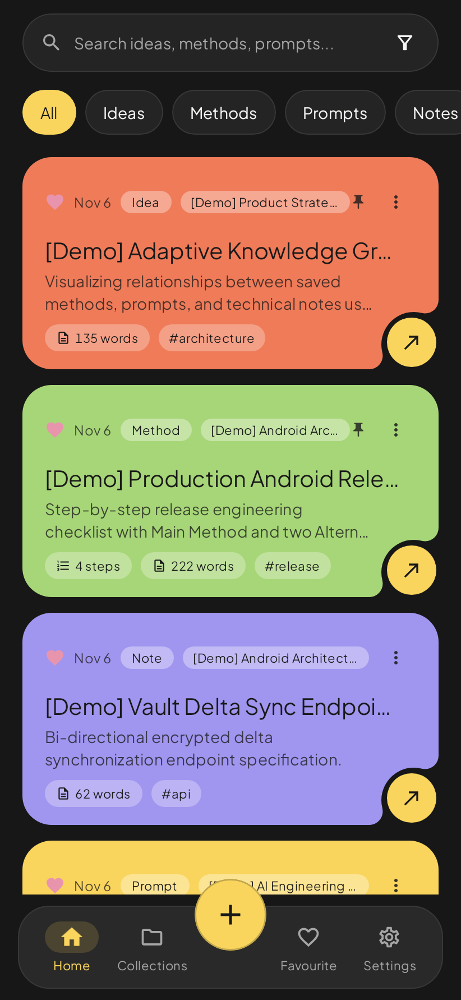
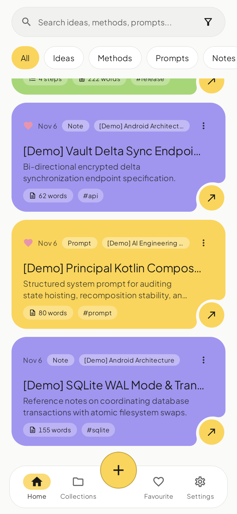
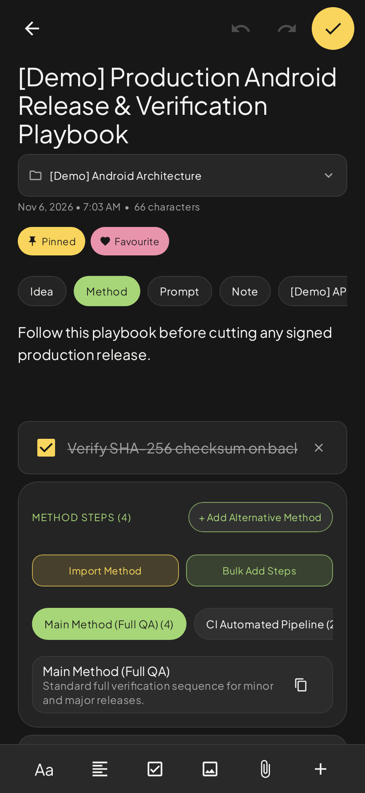

<div align="center">


# IDEAVAULT

**Everything worth remembering.**

An offline-first Android app for ideas, methods, prompts, and notes.

Built by **Rahmathullah · Designwithrahma**.

[](LICENSE)

</div>

## Preview

<p align="center">
  
  
  
</p>

> These screenshots are application UI test captures. They are not photos from a physical phone.

## Features

- **Ideas:** capture thoughts, add details, track progress, and organize your work.
- **Methods:** document steps, alternate routes, and follow progress without changing the original method.
- **Prompts:** store reusable prompts with formatting and placeholders intact.
- **Notes and knowledge:** formatted text, content blocks, checklists, and attachments.
- **Custom types:** add structured information with your own fields.
- **Folders, tags, search, and favourites:** find what you saved locally.
- **Smart Import, Copy for AI, and export:** share and move your content deliberately.
- **Trash, backup, and restore:** local recovery tools for important entries.
- **App Lock, light/dark themes, and onboarding.**

No account is required for the core offline experience. Data is stored locally using Room and DataStore.

## Tech stack

Kotlin · Jetpack Compose / Material 3 · Room · DataStore · Robolectric

Android minimum SDK **24**. App ID: `com.aistudio.ideavault.vltpkx`. Current source version: **2.4.0** (version code 4).

## Build

1. Install Android Studio with an appropriate Android SDK, JDK compatible with Android Gradle Plugin 9.1.1 (JDK 17 or newer), and the SDK platform required by `app/build.gradle.kts` (Android 36.1).
2. Open this repository as an Android Studio project.
3. Let Gradle sync using the **included Gradle 9.3.1 wrapper**.
4. Run the `app` debug configuration on an emulator or Android device.

Alternatively, from the repository root:

```bash
./gradlew :app:assembleDebug
./gradlew :app:testDebugUnitTest
```

On Windows, use `gradlew.bat` in place of `./gradlew`.

**Important:** Android SDK and dependency downloads are required to build; the app itself is designed to work offline. The repository does not include a signing keystore, secrets, or an officially verified release APK. Use your own signing key for production. Existing installations must use the same signing identity to receive app updates.

## Project layout

- `app/src/main/` — Android source code and resources
- `app/src/test/` — unit tests and Robolectric tests
- `app/schemas/` — Room database schema history
- `screenshots/` — selected UI captures
- `docs/branding/` — original logo exports
- `docs/licenses/` — font redistribution license notices

## Privacy

Core content is stored on the device. Attachments are stored in app-private storage. Backups and exports are user-controlled. Review requested Android permissions before installing a build.

## Contributing and security

See [CONTRIBUTING.md](CONTRIBUTING.md) before submitting changes. Report security issues privately using the process in [SECURITY.md](SECURITY.md). For license details and font notices, read [LICENSE](LICENSE) and [THIRD_PARTY_NOTICES.md](THIRD_PARTY_NOTICES.md).

## Status

The source is published for review and development. An independently validated signed release build has **not** been published here yet. Please check build workflows and test results before relying on a release.

## License

IDEAVAULT application code is available under the [MIT License](LICENSE). Bundled Plus Jakarta Sans and JetBrains Mono fonts are separately licensed under SIL Open Font License 1.1, with notices in `docs/licenses/`.

---

Made by **Rahmathullah | Designwithrahma**.
