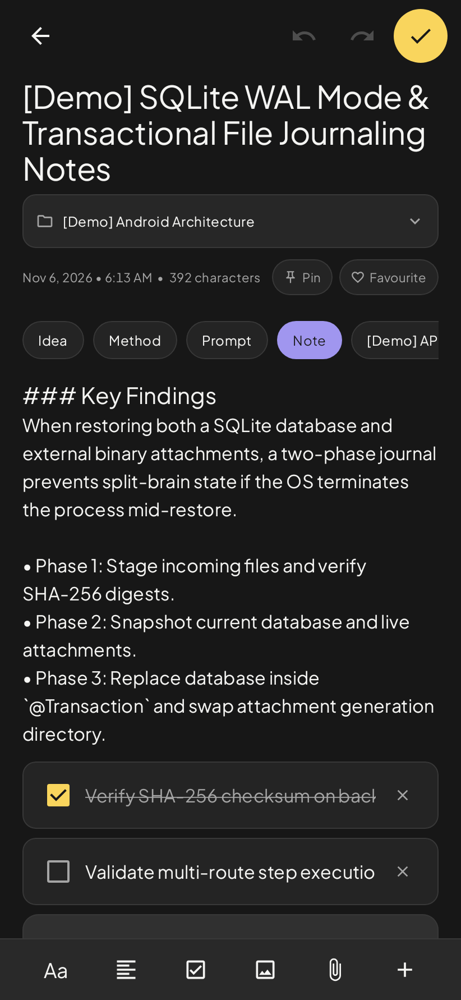
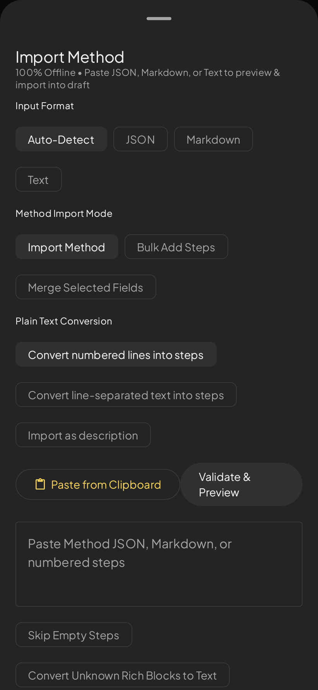
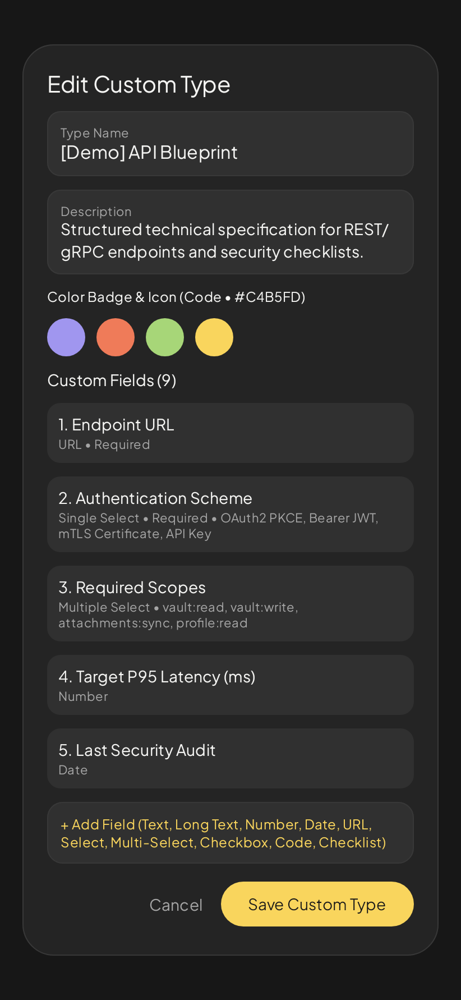

<p align="center">
  
</p>

<h1 align="center">IDEAVAULT</h1>
<p align="center"><strong>Everything worth remembering.</strong></p>
<p align="center">An offline-first Android app to collect ideas, document methods, save prompts and write notes.</p>
<p align="center">
  
  
  <a href="LICENSE"></a>
</p>

## What you can do

- **Ideas:** Save thoughts, track idea status, and organize items with tags, folders and favourites.
- **Methods:** Build reusable workflows with numbered steps, alternative routes and follow progress.
- **Prompts:** Keep original prompt text and whitespace intact.
- **Notes:** Write rich content with text styling, lists, code blocks and attachments.
- **Custom types:** Build your own structured entries and fields.
- **Smart import and export:** Work with JSON, Markdown and plain text, including bulk Method steps.
- **Offline-first:** No account or internet connection is required for your local vault.
- **Privacy tools:** Local App Lock and backup/restore.

IDEAVAULT is **Android-only** in this release. Cloud sync and a web version are not part of v2.4.0.

## App screenshots

Actual UI captures from the project's Android UI/Robolectric testing workflow. These are not AI-generated interface mockups or photographs of physical devices.

| Home (dark) | Home (light) | Method editor |
| :---: | :---: | :---: |
|  |  |  |

| Note editor | Smart Import | Custom Types |
| :---: | :---: | :---: |
|  |  |  |

## Tech stack

Kotlin · Jetpack Compose · Material 3 · Room · DataStore · Coroutines · Robolectric.

- Minimum Android version: **Android 7.0 (API 24)**
- Target SDK: **36**
- Source version: **2.4.0**
- Room database version: **4**, with non-destructive migrations

## Build from source

Install Android Studio, an Android SDK that supports this project's compile SDK, and a compatible JDK. The repository includes the official **Gradle 9.3.1 wrapper**.

```bash
./gradlew :app:assembleDebug
./gradlew :app:testDebugUnitTest
```

On Windows, use `gradlew.bat` instead of `./gradlew`. The debug APK is normally written to `app/build/outputs/apk/debug/app-debug.apk`.

A fresh checkout uses Android's standard debug signing key. **Do not commit signing keys, `local.properties`, credentials, or personal vault backups.** For an update over an existing installed build, the signing certificate must match.

## Release status

The public source repository is being prepared for its initial open-source release. **No verified, signed release APK has been published yet.** Device smoke tests and clean-checkout build verification are separate release checks.

## Contributing

See [CONTRIBUTING.md](CONTRIBUTING.md). To report security problems, see [SECURITY.md](SECURITY.md).

## License & acknowledgements

IDEAVAULT source code is available under the [MIT License](LICENSE). Bundled **Plus Jakarta Sans** and **JetBrains Mono** fonts retain their own SIL Open Font License notices in [docs/licenses](docs/licenses). See [asset licensing notes](docs/ASSETS_AND_LICENSES.md).

Made by **Rahmathullah | Designwithrahma**.
